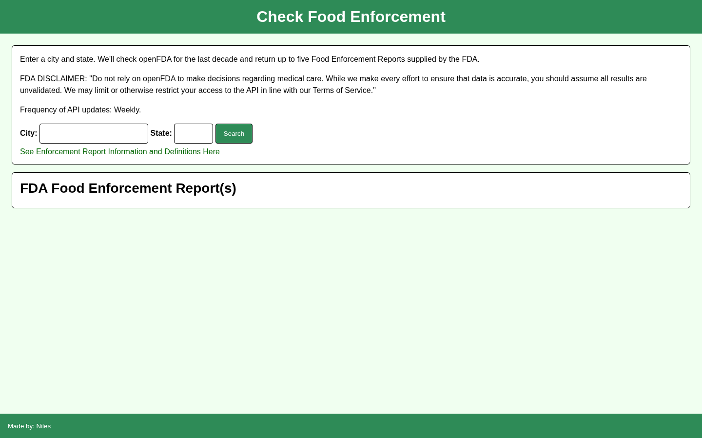
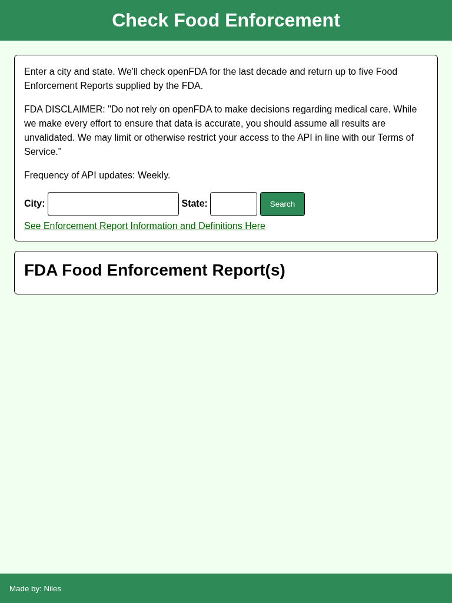
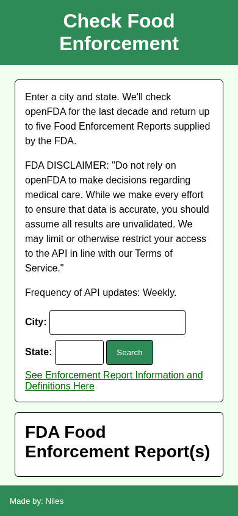

# FDA Food Enforcement Search

Search openFDA food enforcement reports by city and state.

## Overview

FDA Food Enforcement Search lets a user enter a city and two-character state abbreviation to retrieve recent food enforcement reports from the openFDA API.

The application automatically searches the previous ten years, sorts results by report date, and displays up to five matching reports in the browser.

## Features

- Search by city and state
- Automatically create a ten-year search range
- Retrieve food enforcement reports from openFDA
- Sort results by report date
- Return up to five matching reports
- Display available report fields dynamically
- Link to FDA enforcement report definitions

## Technologies

<p>
  <a href="https://developer.mozilla.org/en-US/docs/Web/HTML" title="HTML">
    
  </a>
  &nbsp;
  <a href="https://developer.mozilla.org/en-US/docs/Web/CSS" title="CSS">
    
  </a>
  &nbsp;
  <a href="https://developer.mozilla.org/en-US/docs/Web/JavaScript" title="JavaScript">
    
  </a>
</p>

- [openFDA Food Enforcement API](https://open.fda.gov/apis/food/enforcement/)
- [FDA Enforcement Report Information and Definitions](https://www.fda.gov/safety/enforcement-reports/enforcement-report-information-and-definitions)

## How to Run

1. Clone the repository:

```bash
git clone https://github.com/nilesleesmith/simply-get-FDA-food-reports.git
```

2. Open the project folder.

3. Open `index.html` in a web browser.

No additional packages or build steps are required.

## Data Notice

The application displays the openFDA disclaimer included in the project interface. openFDA data should not be relied upon for medical-care decisions, and returned data may be unvalidated.

The project interface also notes that the API is updated weekly.

## Live Site

Coming soon.

## Screenshots

### Desktop



### Tablet



### Mobile


